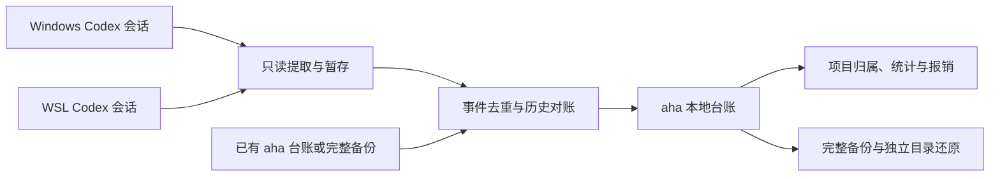

# aha 双端 Codex 用量采集设计

## 数据流

Windows 客户端仍负责调度、SQLite 写入和界面。Windows 直接读已确认的 Codex 根。WSL 使用 `wsl.exe` 在选中的发行版内执行短时只读操作，复用同一份会话用量解析和归一逻辑。两端原始会话各自在原位置写入，aha 只保存统计投影和核对依据。

## 共享合同

| 责任 | 设计 |
| --- | --- |
| 采集来源 | 来源配置包含环境、数据根和绑定身份。WSL 的实例以发行版和实际用户目录确定。按端展示可达性、覆盖以及最后成功时间。 |
| 同步作业 | 保持当前单写入约束。用一个启动或手动作业编排两端，每个来源自己的发布事务同时提交事实、证据和游标。独立记录成功、无变化、部分覆盖、不可用、取消和失败。 |
| 台账身份 | 现有记录键、内容版本、项目关系、占用和冻结成员在迁移中保留。新事实使用可核查的原生事件身份。来源实例和物理文件游标独立于消费身份。 |
| 时间与归属 | 保留事件原始时间依据，统一转为现有时间合同使用的事件秒与北京时间。项目按已确认目录规则归属。无目录依据或跨端复制导致冲突时使用现有待归属与核对能力。 |
| 金额 | 历史参考成本沿用已存值。新用量采用有版本和出处的模型参考价以及精确十进制。价格未知单独呈现，申请金额和币种由现有规则处理。 |
| 输出 | 继续提供明细、历史日汇总、每日和模型查询及四文件报销包。新材料记录项目范围内的来源和参考价依据，复用现有用量投影和字段语义。历史材料使用已存 ZIP。 |

新 `/api/sync` 继续创建后台作业，`/api/sync/{id}` 返回总体进度和逐来源结果。来源设置保存经过验证的根，初始状态区分未关联、已关联与暂不可达。启动同一实例时重用已有启动同步作业，手动重新同步前确认当前来源配置。旧请求回包不能覆盖较新的来源状态或重开已经关闭的对话框。

新材料保留四个文件名与既有兼容字段。`source_schema_version` 继续明确指向内部用量投影。`导出信息.json` 与说明页按实际选中成员描述历史原成本、原生参考价格版本和缺价范围，并随预览和修订冻结。

## 历史与切换

1. 以现有 aha 台账为基线，升级前生成并校验完整备份，在独立资料目录验证可恢复。生产切换从已验收的版本和已核对的资料范围开始。
2. 原生采集先在隔离副本中按范围预演。根据事件及旧明细的可信匹配、日汇总覆盖和已有占用，得到已存在、可新增、待核对与无法恢复明细的部分。切换边界来自实际覆盖和确认结果。
3. 证据充分重复时复用旧记录身份。候选和旧日汇总存在未知重叠时保留双方依据，待用户复核后才影响可用合计。没有源日志的已入账历史继续查询。
4. 新版正式同步从 Codex 原始来源读取。原 CCS 文件和真实资料都保持原位置。当前产品、维护入口及发布验收使用原生日志或 aha 自身备份。

## 备份还原

| 对象 | 处理 |
| --- | --- |
| 完整备份 | 保持 `.aha-backup` 容器及清单格式，继续包含一致的 aha 数据库、所需对象与现有版本原包。新表的消费身份和证据随数据库保留。 |
| 旧完整备份 | 继续校验生产 schema 3/4 的真实结构、清单、关联和原包哈希。在独立还原目录逐级升级，不改归档。 |
| 还原后同步 | 旧事实、项目和冻结包可直接使用。确认本机原生源后重建物理读取进度，事件身份继续参与幂等。即使原日志不可达，历史仍可查。 |
| 原始文件 | Codex 日志不作为 aha 完整备份成员。账户凭据、运行信息和机器配置延续隐私边界。升级所需回滚包采用已校验的旧版 aha 备份。 |

## 分工和依赖

双端采集子任务先交付原生事件投影、版本化的新增表与索引、游标、来源呈现和隔离台账的可验证结果。历史与备份子任务依赖这个稳定投影处理重叠，接入旧版本升级、完整备份验证和正式切换，完成 CCS 退出。schema 5 批准纳入实际升级和产物必须通过两项工作，主任务负责全流程验收和桌面交付。

- [双端采集技术细节](../11-24-codex-native-usage/design.md)
- [迁移、备份和旧入口移除技术细节](../11-24-codex-history-backup-cutover/design.md)
